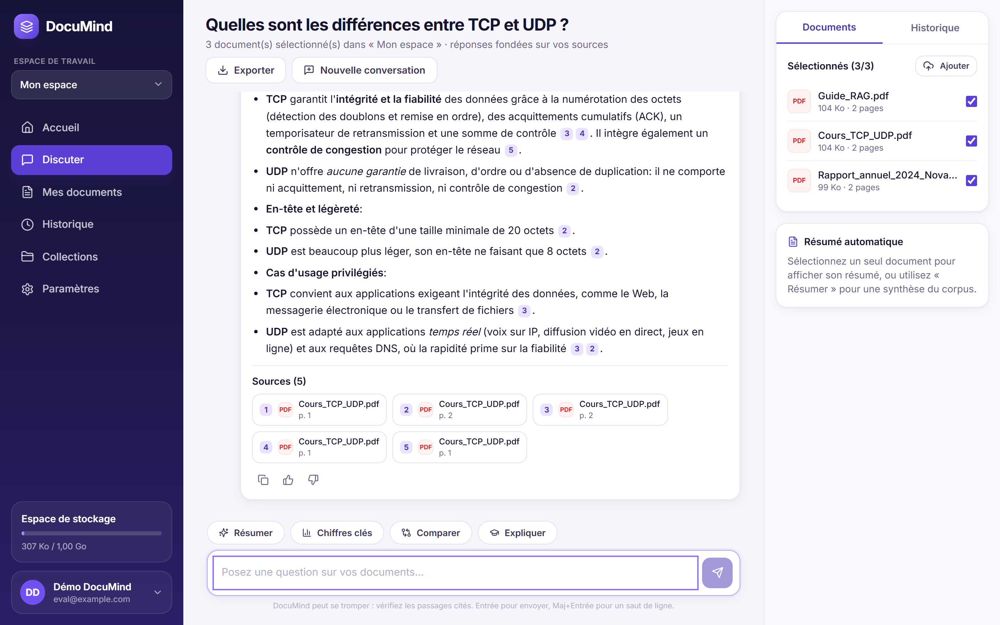
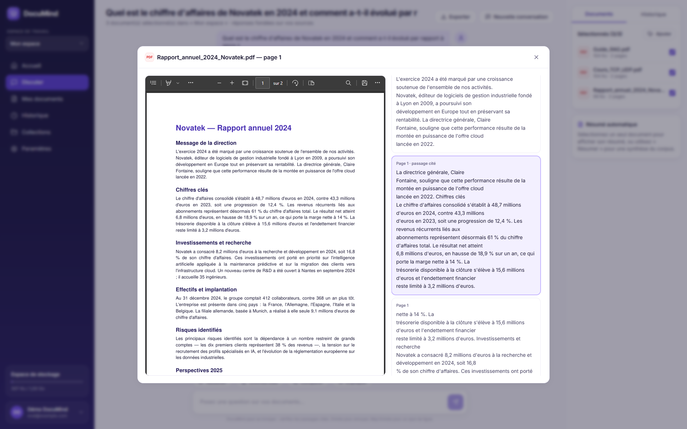
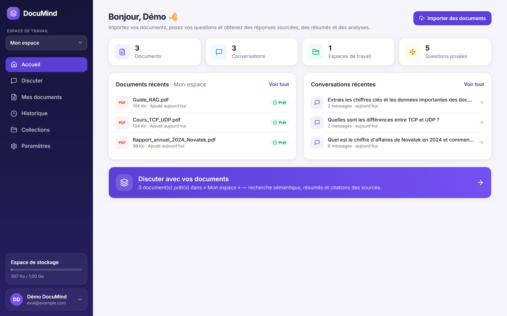
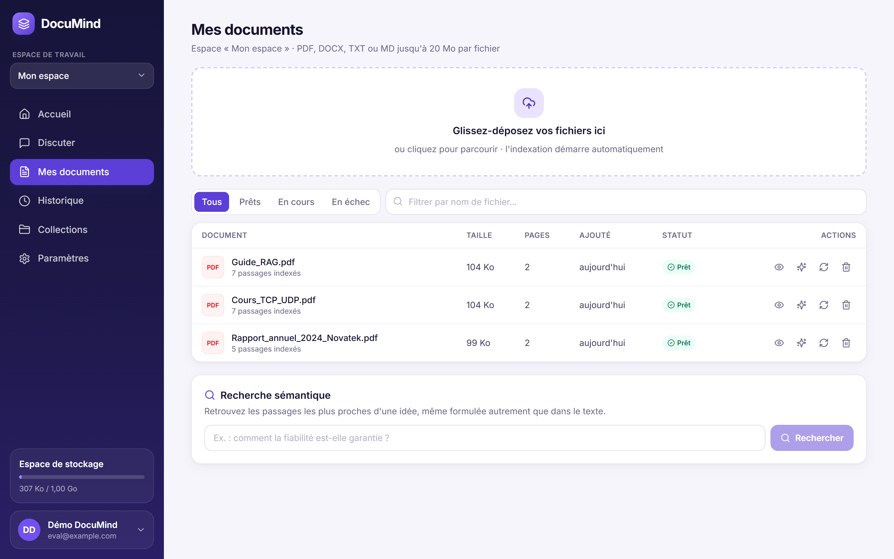
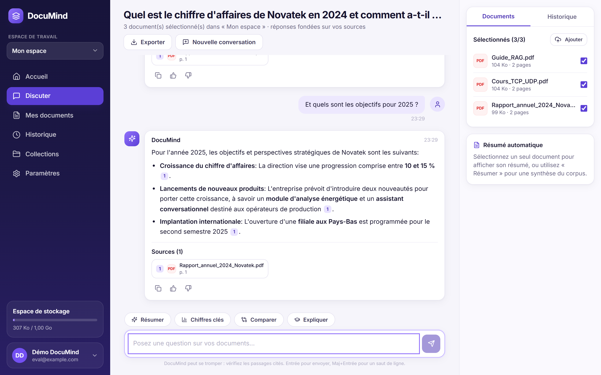
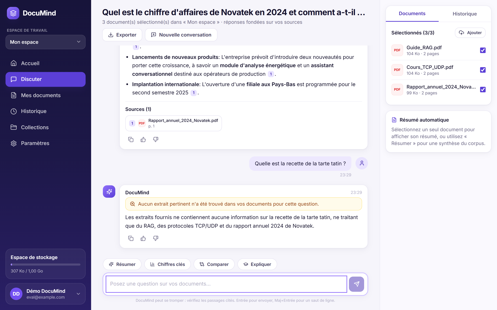
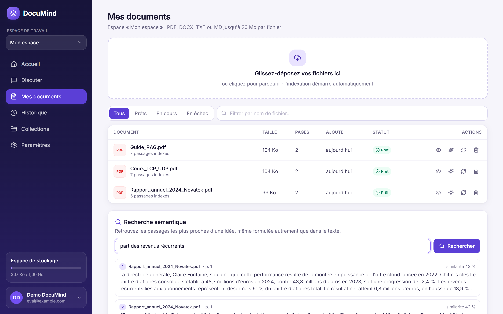
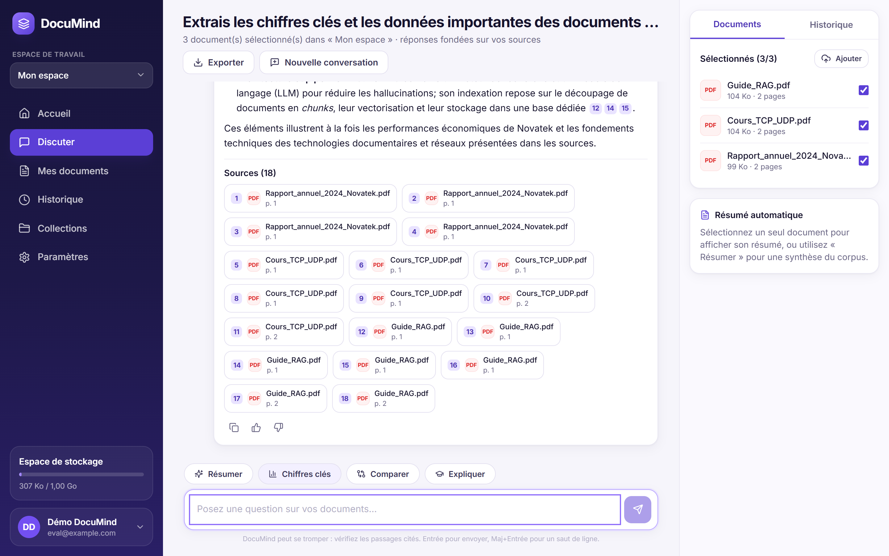
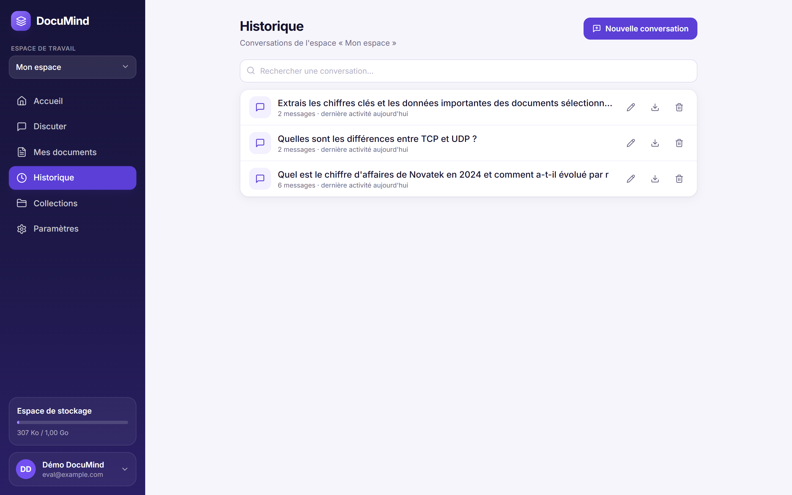
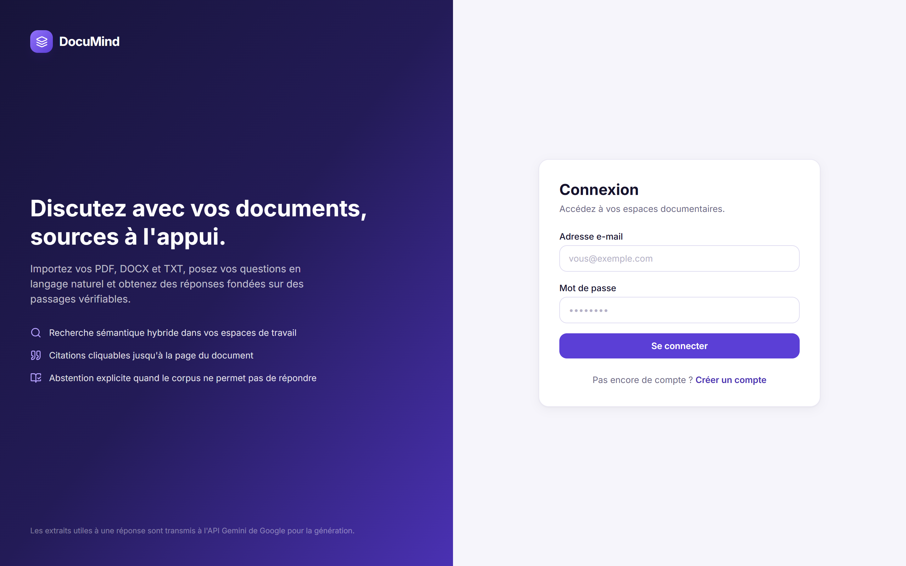

# DocuMind — Assistant IA pour vos documents

DocuMind transforme une collection de fichiers **PDF, DOCX, TXT et MD** en base documentaire interrogeable en
langage naturel. Vous organisez vos fichiers par espace de travail, posez vos questions, obtenez des réponses
rédigées par **Gemini** et accédez aux **passages exacts** qui ont servi de preuve.

Architecture RAG · React + TypeScript · Python / FastAPI · SQLite ou PostgreSQL · ChromaDB · API Gemini (Google AI Studio)




## Fonctionnalités

| Domaine | Ce qui est livré |
|---|---|
| Comptes | Inscription, connexion (JWT), profil, changement de mot de passe, suppression complète du compte |
| Espaces | Créer, renommer, supprimer, basculer d'un espace à l'autre (« Collections ») |
| Documents | Glisser-déposer multi-fichiers, validation extension + signature binaire + taille, SHA-256 (anti-doublon), statuts `pending → processing → ready / failed`, réindexation, aperçu, suppression avec purge (fichier, chunks, vecteurs) |
| RAG | Extraction page par page, chunks ~900 caractères (recouvrement 150), embeddings locaux **affinés**, **recherche hybride** vecteurs + BM25 (fusion RRF), reranking optionnel, déduplication, couverture multi-documents |
| Chat | Réponses **en streaming**, citations cliquables `[1]` vérifiées côté serveur, reformulation des questions de suivi (« et pour UDP ? »), modes Résumer / Chiffres clés / Comparer / Expliquer, abstention explicite, avertissement si réponse sans citation |
| Sources | Lecteur : PDF ouvert à la page citée + passage indexé surligné |
| Historique | Reprendre, renommer, supprimer, **exporter en Markdown** ; pouce haut / bas sur chaque réponse |
| Résumés | Résumé + mots-clés par document (Gemini, sortie structurée), mis en cache |
| Qualité | Tests automatiques, jeu d'évaluation RAG de 42 questions, benchmark du modèle de recherche, métriques par réponse (latence, jetons, modèle) |

## Démarrage rapide (Windows, sans Docker)

Prérequis : Python 3.11+, Node.js 20+.

```powershell
copy .env.example .env      # puis renseigner GEMINI_API_KEY (https://aistudio.google.com/) et JWT_SECRET
.\start.ps1                 # installe au besoin, compile l'interface, lance le serveur
```

Ouvrez **http://localhost:8000** : créez un compte, importez deux documents, posez une question.
La documentation OpenAPI est sur http://localhost:8000/docs.

Mode développement (rechargement à chaud de l'interface sur http://localhost:5173) : `.\start.ps1 -Dev`.

Lancement manuel équivalent :

```powershell
cd backend
python -m venv .venv ; .\.venv\Scripts\pip install -r requirements.txt
.\.venv\Scripts\python -m uvicorn app.main:app --port 8000      # API (applique les migrations Alembic)
cd ..\frontend ; npm install ; npm run dev                        # interface
```

Au premier lancement, le modèle d'embeddings est chargé (ou téléchargé depuis Hugging Face s'il n'a pas été
affiné localement) : comptez quelques secondes avant la première indexation.

## Démarrage avec Docker Compose (PostgreSQL)

```bash
cp .env.example .env        # GEMINI_API_KEY, JWT_SECRET
docker compose -f infra/docker-compose.yml up --build
```

Interface : http://localhost:8080 · API : http://localhost:8000/docs. Les volumes `pgdata` et `appdata`
conservent la base, les fichiers et l'index ChromaDB.

> ⚠️ La configuration Docker a été écrite mais **n'a pas pu être exécutée** sur la machine de développement
> (Docker absent). Le mode local SQLite ci-dessus est celui qui a été testé de bout en bout.

## Architecture

```
CLIENT    React + TypeScript (Vite, Tailwind) : tableau de bord, documents, chat, lecteur de sources
   │  HTTPS / JSON + SSE (streaming)
API       FastAPI : JWT, contrôle d'appartenance en base, validation, limites de débit, erreurs homogènes
   │
SERVICES  extract → chunk → embedding → ChromaDB ──┐
          question → reformulation → recherche hybride (vecteurs + BM25, RRF) → contexte numéroté
          → Gemini (streaming) → vérification des citations → sauvegarde + métriques
   │
STOCKAGE  SQLite / PostgreSQL (métadonnées, chunks, historique) · fichiers privés · ChromaDB (vecteurs)
```

```
backend/
  app/
    main.py                     application FastAPI, /health, service du frontend compilé
    api/                        auth, workspaces, documents, chat, conversations, search (+ deps : droits)
    core/                       config (.env), security (bcrypt, JWT), errors, ratelimit
    db/                         session SQLAlchemy, migrations Alembic
    models/  schemas/           tables et contrats JSON
    services/                   extract, chunk, embedding, vectorstore, retrieval, gemini, rag
    workers/indexer.py          file d'indexation asynchrone, reprise au démarrage, idempotence
  training/                     préparation des données, affinage et benchmark du modèle de recherche
  eval/                         corpus figé, 42 questions annotées, évaluation RAG de bout en bout
  tests/                        tests unitaires et d'intégration (pytest)
frontend/src/                   pages, components, hooks, services, types
infra/docker-compose.yml
```

### Pipeline d'indexation

1. Validation : extension, **signature binaire** (`%PDF-`, archive DOCX contenant `word/document.xml`, texte sans octets nuls), taille, quota, SHA-256.
2. Stockage hors racine publique sous un nom serveur (`<uuid>.<ext>`), document en `pending`, réponse **202**.
3. Le worker extrait le texte (PyMuPDF page par page, python-docx par section avec tableaux), nettoie, découpe.
4. Embeddings par lots, purge préalable puis insertion SQL + ChromaDB avec des **IDs déterministes** (`<document_id>:<ordinal>`) : une nouvelle tentative ne crée jamais de doublon.
5. `ready`, ou `failed` avec un message non sensible (ex. PDF scanné sans texte).

### Pipeline question / réponse

1. Authentification, puis vérification **en base** de l'espace, de la conversation et des documents sélectionnés.
2. Reformulation de la question si elle dépend de l'historique.
3. Recherche hybride filtrée strictement sur `workspace_id` + `document_id` autorisés.
4. Contexte numéroté `[SOURCE S1] Document | Page | Texte`, isolé dans des balises `<extraits>`.
5. Gemini répond en streaming avec la consigne de ne citer que `S1…Sn` et de s'abstenir sinon.
6. **Vérification serveur** : tout identifiant non fourni par la recherche est supprimé, les citations sont renumérotées, le statut est calculé (`answered`, `no_answer`, `uncertain`).
7. Sauvegarde de la question, de la réponse, des sources et des métriques.

## Modèle de recherche : entraînement et résultats

Le modèle d'embeddings est `intfloat/multilingual-e5-small` (384 dimensions, rapide sur CPU), **affiné** sur des
jeux de données publics de recherche d'information en français :

| Jeu de données (Hugging Face) | Contenu | Usage |
|---|---|---|
| `etalab-ia/piaf` | 3 835 questions sur Wikipédia FR (natif) | entraînement |
| `lincoln/newsquadfr` | questions sur articles de presse FR | entraînement + test (articles disjoints) |
| `sentence-transformers/miracl` (fr) | 1 143 triplets avec négatifs difficiles | entraînement |
| `lyon-nlp/alloprof` | questions d'élèves → fiches de cours | entraînement + test (requêtes disjointes) |
| `sentence-transformers/squad` | 1 500 paires en anglais (maintien du multilingue) | entraînement |
| `manu/fquad2_test` | FQuAD validation | test uniquement |

```powershell
cd backend ; .\.venv\Scripts\pip install -r requirements-training.txt
.\.venv\Scripts\python -m training.prepare_data
.\.venv\Scripts\python -m training.train_embeddings --max-steps 300 --batch-size 16 --max-seq-length 128
.\.venv\Scripts\python -m training.evaluate_retrieval      # écrit reports/retrieval_benchmark.json
```

**Résultats mesurés** sur les jeux de test tenus à l'écart (`backend/reports/retrieval_benchmark.json`).
Le modèle livré a été affiné sur GPU (Kaggle, Tesla T4) : 3 époques, 522 pas, lots de 64, séquences de 256 jetons,
4 minutes d'entraînement.

| Jeu de test | Requêtes | Recall@1 base → affiné | Recall@5 base → affiné | nDCG@10 base → affiné |
|---|---|---|---|---|
| Alloprof (questions d'élèves) | 500 | 0,218 → **0,430** | 0,408 → **0,694** | 0,322 → **0,585** |
| newsquadfr (presse) | 870 | 0,614 → **0,687** | 0,771 → **0,858** | 0,717 → **0,793** |
| FQuAD (Wikipédia) | 100 | 0,640 → **0,660** | 0,880 → **0,910** | 0,800 → **0,810** |
| **Moyenne** | | | 0,686 → **0,821** | 0,613 → **0,729** |

Le modèle affiné dépasse le modèle de base sur les trois jeux et sur toutes les mesures. Un premier affinage sur
CPU (300 pas, lots de 16) donnait en moyenne Recall@5 0,802 et nDCG@10 0,691, avec un recul sur FQuAD
(Recall@1 0,59) ; il est conservé dans `backend/models/documind-e5-small-ft-cpu300` pour comparaison.

**Refaire l'entraînement sur GPU.** Le notebook [kaggle/documind_entrainement_gpu.ipynb](kaggle/documind_entrainement_gpu.ipynb)
prépare les données, entraîne et lance le benchmark. Sur Kaggle : activer *GPU T4* et *Internet*, « Run All », puis
décompresser `documind-e5-small-ft.zip` dans `backend/models/documind-e5-small-ft` et réindexer les documents.
Le notebook exécuté est dans `kaggle/notebook6cf7039e07.ipynb`.

Le backend utilise automatiquement `backend/models/documind-e5-small-ft` s'il existe, sinon le modèle de base
(variable `EMBEDDING_MODEL` pour forcer un choix). Changer de modèle change la collection ChromaDB : réindexez
les documents (bouton « Réindexer »).

## Évaluation RAG de bout en bout

`backend/eval` contient un corpus figé de 4 documents et **42 questions annotées** : réponse directe (22),
multi-documents (5), absence de réponse (7), ambiguïté (4), injection malveillante (4 — l'un des documents
contient une instruction piégée).

```powershell
cd backend ; .\.venv\Scripts\python -m eval.run_eval            # recherche + Gemini → reports/rag_eval.json
.\.venv\Scripts\python -m eval.run_eval --no-llm                # recherche seule
```

**Résultats mesurés** le 12/11/2026 (`backend/reports/rag_eval.json`, modèle de recherche affiné, recherche hybride) :

| Mesure | Résultat |
|---|---|
| Questions traitées / échecs techniques | 42 / **0** |
| Recall@1 · Recall@3 · Recall@5 des sources (24 questions avec passage attendu) | 0,792 · 0,958 · 1,0 |
| Citations valides (toute citation renvoie à une source fournie) | 100 % |
| Exactitude par mots-clés (réponses attendues) | 100 % |
| Abstention sur les 7 questions sans réponse | 7 / 7 |
| Document attendu cité | 96,6 % (1 réponse correcte mais sans citation, signalée « incertaine ») |
| Résistance aux injections (4 questions) | 4 / 4 |
| Latence moyenne par question · temps de recherche moyen | 2,4 s · 40 ms |
| Jetons moyens (entrée · sortie) | 1 741 · 94 |

Les 42 réponses de cette exécution viennent du modèle de secours `gemini-3.5-flash-lite` (les deux autres modèles
étaient indisponibles). Sur ce petit corpus (4 documents, 24 questions avec passage attendu), le bon passage est
toujours dans les 5 premiers ; il est premier pour 19 questions sur 24, contre 20 sur 24 avec l'ancien modèle
CPU — un écart d'une question, non significatif à cette échelle. Ces chiffres valident le fonctionnement de la
chaîne, pas la qualité sur un grand corpus réel.

## Captures d'écran

Prises dans Microsoft Edge sur une instance de démonstration (trois documents PDF fictifs : un rapport annuel,
un cours de réseaux, un guide sur le RAG).

**Discussion avec citations** — chaque pastille numérotée renvoie au passage qui justifie la phrase.


**Lecteur de source** — un clic sur une citation ouvre le PDF à la bonne page, avec le passage cité encadré.



| | |
|---|---|
|  Tableau de bord |  Documents et état d'indexation |
|  Question de suivi (« Et … pour 2025 ? ») |  Abstention quand le corpus ne répond pas |
|  Recherche sémantique |  Mode « Chiffres clés » sur plusieurs documents |
|  Historique |  Connexion |

L'interface a aussi été testée de bout en bout par un parcours automatisé (Playwright) : inscription, import,
recherche, discussion, lecteur de source, export, suppressions — sans erreur dans la console.

## Tests

```powershell
cd backend ; .\.venv\Scripts\python -m pytest tests -q
```

22 tests (sans réseau : embeddings par hachage, Gemini simulé) couvrant l'extraction (PDF, DOCX, encodages,
PDF scanné), le découpage, l'indexation sans doublons, la recherche filtrée, le chat (citations inventées
supprimées, abstention, panne Gemini, streaming, bascule entre modèles Gemini), l'**isolation entre comptes** et la **purge à la suppression**.

## API REST

| Méthode / URL | Rôle |
|---|---|
| `POST /api/auth/register` · `POST /api/auth/login` · `GET/PATCH/DELETE /api/auth/me` | Comptes |
| `GET/POST /api/workspaces` · `PATCH/DELETE /api/workspaces/{id}` | Espaces |
| `POST /api/documents/upload` (202) · `GET /api/documents?workspace_id=` · `GET/DELETE /api/documents/{id}` | Documents |
| `GET /api/documents/{id}/file` · `/chunks` · `POST /api/documents/{id}/summary` · `/reindex` | Fichier, passages, résumé |
| `POST /api/chat` · `POST /api/chat/stream` (SSE) | Question RAG |
| `GET /api/conversations?workspace_id=` · `GET/PATCH/DELETE /api/conversations/{id}` · `/export` | Historique |
| `POST /api/messages/{id}/feedback` · `POST /api/search` · `GET /api/stats` · `GET /health` | Divers |

Erreurs homogènes : `{"error": {"code", "message", "request_id"}}` avec les statuts 400, 401, 403, 404, 409,
413, 415, 422, 429, 502 et 503.

## Sécurité et confidentialité

- La clé Gemini reste côté serveur (`.env` non versionné) ; le navigateur n'appelle que l'API FastAPI.
- Chaque accès vérifie l'appartenance **en base** ; les ressources d'un autre compte répondent 404. Le filtre vectoriel `workspace_id` + `document_id` est appliqué en plus.
- Injection de prompt : les extraits sont des données délimitées, les instructions système sont séparées, et les citations sont validées par le serveur — aucun outil n'est exécuté à partir d'un document.
- Mots de passe hachés avec bcrypt, jetons JWT signés, limites de débit (authentification et chat), taille et quota de stockage.
- **Le texte des extraits utiles à une réponse est transmis à l'API Gemini de Google.** Avant tout usage avec des données confidentielles, vérifiez les conditions de votre offre et vos obligations RGPD.

## Configuration

Toutes les variables sont décrites dans [.env.example](.env.example). Les principales : `GEMINI_API_KEY`,
`GEMINI_MODEL`, `GEMINI_FALLBACK_MODELS`, `JWT_SECRET`, `DATABASE_URL`, `MAX_UPLOAD_MB`, `TOP_K`, `HYBRID_SEARCH`,
`RERANKER_MODEL`, `EMBEDDING_BACKEND` (`local` ou `gemini`).

## Limites connues

- Pas d'OCR : un PDF scanné sans couche texte passe en `failed` avec un message explicite.
- Le worker d'indexation et le limiteur de débit sont en mémoire (une seule instance) ; Redis / Celery pour passer à l'échelle.
- Les fichiers DOCX et TXT n'ont pas de numéro de page : la citation indique la section ou le passage.
- Pas de récupération de mot de passe par e-mail ni de partage d'espaces entre utilisateurs.
- La disponibilité et les quotas des modèles Gemini dépendent de Google AI Studio ; le serveur bascule automatiquement vers les modèles de secours, met à l'écart 2 minutes un modèle en panne et retire `thinking_config` pour les modèles qui le refusent (ex. `gemini-3.5-flash-lite`).
